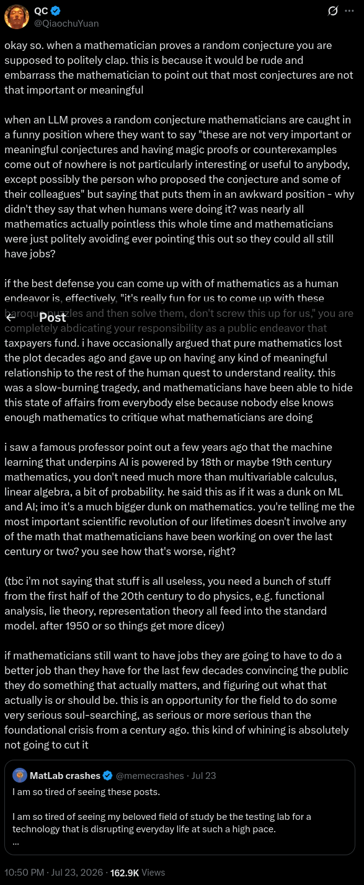

Here's my high level question: there's all this fancy math you can learn, but at the end of the day, it seems like most cutting edge techniques are actually still just based on relatively simple math. Why aren't we using the really complex stuff? Why doesn't it give us amazing new tools?

## What do I mean by "fancy math"?

In my somewhat arbitrary (but IMO reasonable) delineation, there's a small set of "core basics" math topics, and the stuff I'm calling "fancy math" is almost everything else. I.e., areas that require the basics as a prerequisite, or are conceptually harder, or more exotic, etc.

By the basics, I mean topics that you'd probably encounter in the first year or two of a CS/math/physics/engineering undergrad degree. Examples would be topics like calculus, linear algebra, probability and stats, and maybe some discrete math or analysis or differential equations.

And to be clear, I mean basic versions of all these courses -- it's obviously also arbitrary to talk about "probability and stats" since the field can go arbitrarily deep. So roughly, I mean the average depth that you'd be exposed to in that first half of college.

Some examples of what I mean by "fancy math" would be topics like group/field/etc theory, topology, differential geometry, optimal control theory, etc. Now, when you read this, depending on your background, you might be scoffing and thinking "hah, you simpleton, *that's* not complex math! I thought you meant something *actually* hard like XYZ." 

But that's kind of my point! Those topics I mentioned are more like "back half of undergrad / early grad school", so it's not like they're crazy abstruse.

## Examples, in both directions

Alright, so let's look at some examples of the phenomenon I'm talking about, where the cutting edge techniques rely mostly on simple math. I'll use examples of what I'm most familiar with at this point, which is ML and more specifically RL.

The basics of neural networks and supervised learning primarily rely on linear algebra and a bit of calculus. For some models, you might need to know some basic probability. Even modern LLMs, which are insanely complex hodgepodges of hacks and empirical findings and engineering wizardry, are still fundamentally pretty simple math when it comes down to it.

The RL problem is generally a harder problem than most supervised ML (owing to its nonstationary aspect among other problems), but the tools used to solve it are still pretty simple. The models are still NNs, just sometimes with copies and empirical update schedules. The loss functions are still mostly MSE or increasing log probs. There are also a million empirical hacks, but it's still mostly built on basic math.

Here are a couple examples of what I *would* consider fancier math being applied to RL: one is the paper I discuss in [this post]({{site.baseurl}}/laplacian_in_rl_wu_et_al), where they use concepts like the Laplacian, constrained optimization, and some slightly less basic linear algebra ideas. Another would be the ideas from the QRL paper and prerequisite IQE paper (subjects of future posts), where they use some functional analysis-y concepts and some stochastic processes stuff.

(I know that math might not be fancy at all to you! The low bar is part of the point here.)

However, while I think those papers are really cool, AFAIK they haven't seen wide usage. I basically haven't seen any usage of the Laplacian one. The quasimetric ones actually do seem to be getting some foothold in the GCRL niche, but this is still a subsection of a small niche.

Outside of ML, from the little I know, some cryptography is legitimately built on some clever group theory, and some theoretical physics is certainly using things like differential geometry. So it's out there in other fields, at least a bit.

## The implicit premise

There's a premise baked into my question, which is that fancy math *should* give us better techniques. Is that expectation fair?

I think so. My impression is that most areas of math came about because there was some question they were trying to answer at the time, and they realized the current tools didn't really do it. So, they built up some new formalism over time, and eventually emerged with the *new ability* to do something that couldn't be done before.

As a simple example, intro calculus gives you the ability to analytically calculate integrals and then calculate volumes/etc with the resulting function. It was *possible* to calculate those things without it via summing up a bunch of small values, but being able to get the same result (where possible) by just plugging in the integration bounds is truly a new ability.

I also want to head off one response you might give: the "beauty for its own sake" argument. I.e., that for some math fields, they aren't *meant* to have an application, it's just a cool thought puzzle and fun to chew on. I totally respect that motivation, and it's probably true for some very abstract math, but I don't think it really applies to most of the ones I'm talking about, where you'll at least see lip service to supposed problems mastery of the topic can help solve.

## What I'm *not* talking about

A pet peeve of mine is when certain areas of math claim that they're really useful, but when you go to see what they're actually "used for", it's descriptive at best. 

For example, they'll show that for some problem, traditionally in field A, you can set it up in the formalism of this new math field, B. Then, you solve the problem using the process in B, and get a solution. And wouldn't you know it, it's the same solution that they found in field A!

That can be cool, and has the potential to be exciting. E.g., you can imagine using this new method to solve problems you couldn't before, from other fields.

But... it feels like when I go to see if they've, you know, *actually done that*, it turns out it's all just describing existing solutions rather than ever using the method to solve a previously unsolved problem.

>>learn of a new area of math
>>about to open a textbook on it
>>ask professor if the topic is just descriptive of solutions other topics have already come up with
>>he doesn't understand
>>explain the difference between producing new solution methods vs just describing existing ones in a new language
>>he still doesn't get it
>>pull out my handwritten blog post to show the difference
>>he laughs and says it's fine
>>spend a month reading topic textbook
>>it's just descriptive of existing solutions

Maybe I'll reveal myself as an uneducated rube here, but one subject that feels particularly guilty of this is [category theory](https://en.wikipedia.org/wiki/Category_theory). A while ago I spent a little time learning the (very) basics of it, and looked at some examples of what people called "applied" CT. I remember it being *exactly* what I described above: they'd take something like electronic circuits or RL or a typical ML problem, and then show how it could be formalized with CT. IIRC, often they'd also show how the solution that CT gave when you expressed the problem in the CT framework was actually the same as the known common solution the field currently uses.

## A few hypotheses

Alright, so far I've complained a bunch and tried to show that there *is* this problem, but haven't offered any ideas for why it's the case (much less what to do about it!). Here are a few. None of them are super convincing to me, but they're my best guesses.

### The "people problem"

A lot of what I'm talking about here is basically a divide between "theory" and "practice" (or "praxis" if you're an insecure academic). With the caveat that it's obviously reductive, there are broadly two camps: people who are into solving theoretical problems because the problems are cool and fun, and people who are trying to "get a specific thing to work".

I hope my phrasing doesn't make it sound like I think one group is better than the other, because I genuinely don't! My point is just that they have different motivations which could explain the gap. For the fancy math to get used, it would require both A) the theory getting developed, and B) the experimental practice of implementing it and figuring out all the little practical parts that let it work. My hypothesis here is that the divide doesn't get bridged because each of the two camps does their part, but isn't so interested in doing the other part (and, to a lesser extent, probably has stronger skills in their own area, too). 

I've read so many papers where some theorists come up with a cool idea and prove why it has to work, and then have a halfhearted experiments section at the end, where they very clunkily show it working on a very unimpressive toy problem. On the other hand, I've read a ton of papers where more experiment-focused authors show impressive results on legit problems using some new method, but then completely gloss over *why* the method is working, let alone any sort of proofs for performance guarantees/etc.

So I think of this as a "people problem" because it's really more about how researchers are trained and possibly work together (rather than the one below, which might be a fundamental problem). The good news is that if this is the problem, it's relatively solvable by encouraging each side to put more effort into learning and working with the other side.

### Something about emergent phenomena, the structure of the universe, something something

This guess is less clear cut but IMO more interesting, so humor me on some inchoate rambling 😛

As a motivating example, let's consider classical mechanics. If you've ever taken a class on this subject (especially grad level), you know that it can get veeeeery complex. Yet on some level, everything the topic describes and formalizes is the result of very simple physical interactions.

For example, an early topic you'll consider in CM is a catenary, like a rope hanging between two points. All that's "happening" on a physical level is: each infinitesimal section of rope is pulled on by its neighbors, and gravity pulls every part of the rope down. But if you try to mathematically *describe* this, starting from those basic assumptions, [you'll quickly find](https://en.wikipedia.org/wiki/Catenary#Analysis) that it's a lot more complex than you'd expect! I think most lay people have the sense that the math for a bead sliding along a wire on a merry-go-round won't be nearly as complex as an electron in an atom, but it can be.

As another example, you can very easily code up a little physical simulation that has a few local rules determining how the component particles interact, yet find that it gives rise to chaotic behavior in the aggregate that's not trivial to mathematically describe.

It also seems like there's some version of this in E&M, or maybe certain types of engineering, where there are fancy and complex theorems to say how electric fields or stresses within an object should behave, but at the end of the day for practical uses, people are forced to use [finite element methods](https://en.wikipedia.org/wiki/Finite_element_method). I don't mean to make it seem like numerical methods are simple at all, but hopefully you get my point. They're not "elegant" in the same way as the analytic methods where you get an exact solution in the form of an infinite sum of Bessel functions or whatever.

Here's my best stab at saying this vague feeling briefly: maybe all the complex phenomena we see in the world are actually the result of large systems of simple elements interacting with pretty simple rules. I.e., what's sometimes called "emergence". Using fancy math, we can come up with high level ways to *describe* the systems, but when we want to actually do something with them, we end up falling back on simple building blocks.

Why are the simple building blocks so effective compared to other approaches? I dunno. This seems related to the [Bitter Lesson](https://en.wikipedia.org/wiki/Bitter_lesson). It seems like a premise I'm dancing around here is that there's a kind of ladder of abstraction layers in nature, and it goes in only one direction -- from local/easily described/more "real" layers, to less local and more abstract layers. I'm sure smarter people than me would have examples of where this fails. However, if we're willing to buy that, then it wouldn't surprise me if we need simple but flexible building blocks to mimic and manipulate the world: trying to do it "top-down" is trying to cram the square peg of irreducible complexity into the round hole of some constrained elegant theory. That's doomed to fail, and the best we can do is try to supply our own mushy pile of complexity that can fill the mold of the problem at hand.

### The end result looks simple, the path to it is thorny

There's a very Reddit-brained just-so story I've read online a million times, where someone tells the story of a seasoned mechanic/IT professional/software consultant/etc hired to fix some problem. They briefly look at the issue, and then fix it in five minutes with a simple solution, like tweaking one specific knob or installing one specific package. The boss is outraged at their large fee, yelling that they only spent five minutes working, how can they justify this bill!?

The redditor smugly replies that although the solution took them only five minutes to do, they only knew the correct knob to turn from their twenty years of experience. And then everyone stood up and clapped, yadda yadda blah blah blah.

I bring this up because although it's a dumb reddit pattern, it makes me think about what a fancy math result *would* look like in practice, and if I'd appreciate it, or just dismiss it as not fancy. If the latter is true, then I'm kind of asking for the impossible here.

For example, let's say we do a ton of fancy math to try and solve our ML problem, and at the end of it all, we find that this fancy new theory says that we should add a simple extra term to our usual objective. Would this satisfy me?

On one hand, this is ideal! Lots of the theory-based ideas I've seen end up prescribing really messy and ugly implementations, which is why you often see paper authors really emphasizing "and you just add this *one term* to any standard objective!" So if the theory really gave us a nice simple term that fixes everything, it'd be really great.

OTOH, I can also imagine myself reacting like the reddit story boss. The problem with it being so simple is that it's often kind of interpretable without the theory backing, and then it can feel like they found a (reasonable) trick, and then the theory is kind of just supplemental to it.

One example of this could be constrained optimization. Let's say you want to solve the optimization problem:

$$
\min_x f(x)
\text{ s.t. }
g(x) = c
$$

We can learn about Lagrange multipliers and KKT conditions and the duality gap and projected subgradients and *blah blah blah*. But let's say you naively thought to yourself, "I'd like to use gradient descent on $f(x)$, but I don't know what to do about that tricky constraint... wait, since we want $g(x)$ to be equal to $c$, what if we just add a penalty to $f(x)$ that's based on how far off $g(x)$ is from $c$? And then make that penalty coefficient update as well, to try and make it enforce the penalty the more it's violated?" 

If you followed that logic, you'd rewrite the problem as:

$$
\min_x \max_\lambda f(x) + \lambda (g(x) - c)
$$

and then do typical gradient updates on this objective for both $x$ and $\lambda$. There's so much background and justification for primal-dual gradient methods, but at the end of the day this is basically what a ton of papers do when they want to get an approximate solution to that constrained optimization problem (please don't kill me I know it's not all so simple). My point is that I can imagine being shown this way of setting up the problem and thinking it seems reasonable, but why was a ton of theory needed to get it? 

I guess if it was truly only discovered as a result of that theory, that justifies it. But a lot of the time it seems like it's stuff more like "we noticed the model weights get really big when it overfits. What if we try adding a penalty based on how big they are?" and then theory justifies the totally reasonable thing.

### Maybe the new field itself is the complex math

Okay, one last desperate stab at a guess.

The way I posed my question above, I was saying that a field like RL is using simple math, and I'm confused why it's not using some fancier math, like topology for example. But why *am* I saying topology is fancy? I think part of it is that topology has all these "structures" it builds up as you learn about it, and they're relatively foreign concepts with intuition you need to learn to build.

For example, it's not like the actual building blocks of (point set) topology are that complex - you need some basic set theory and logic concepts, and then you start defining (more abstract) objects and structures, and you're off to the races. The difficult part is really where you start building more structures out of previous structures and stacking them on top of each other, and have to understand how they all fit together.

However, I think we could describe RL this way too! Maybe I'm asking RL to *use* topology, when I should really be viewing it as being in the same *class* as topology. The building blocks themselves are pretty simple math (probability, linear algebra, calculus), but we use those to create (more abstract) structures like value functions and policies, and the difficult part of the field is gaining the intuition for how those things can combine and interact and build on top of earlier ones.

With all that said... I also don't really find this one satisfying either. 

First of all, the original question kind of remains: even taking for granted that RL is itself in the class of "fancy math", why can't we apply other fancy math to it, to help out? I don't have enough background to know how much this is actually happening with other subdisciplines. Maybe they're all just more siloed than I think?

Second, I don't actually believe that RL is in the same class as the others. More specifically, it doesn't feel as "deep" as something like topology yet, in how much its formalism is built up. In RL, there are a few major theorems, and then a bunch of smaller ones that are important but lesser known, and then a million tiny ones in the literature, but it still feels relatively "shallow" in terms of meaningful theory.

## Beaten to the punch

After writing 95% of this post and then letting it sit in my drafts folder for an eternity, I saw [this post](https://x.com/QiaochuYuan/status/2080485791952928868) on twitter from the intimidatingly smart Qiaochu Yuan. Here's the relevant snippet:

>i saw a famous professor point out a few years ago that the machine learning that underpins AI is powered by 18th or maybe 19th century mathematics, you don't need much more than multivariable calculus, linear algebra, a bit of probability. he said this as if it was a dunk on ML and AI; imo it's a much bigger dunk on mathematics. you're telling me the most important scientific revolution of our lifetimes doesn't involve any of the math that mathematicians have been working on over the last century or two? you see how that's worse, right?

Yeah, that's pretty much hitting the nail on the head. Let this be a lesson kids: hit publish, send it, don't look back, don't let it sit in your drafts folder.

and the full post screenshotted for posterity:

